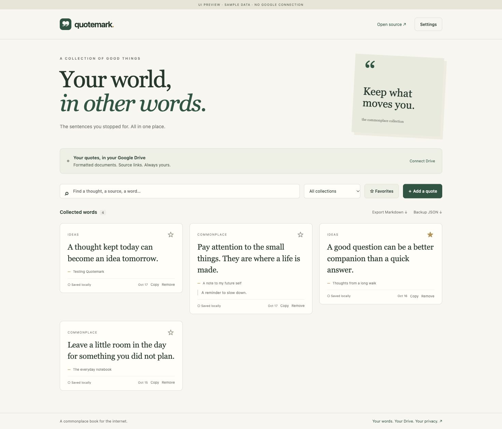

# Quotemark ❞

**Keep the words that stay with you.** An open-source Chrome extension that saves highlighted text and collects it in formatted Google Docs in your own Google Drive.

[Source](https://github.com/Malanaa/quotemark) · [Releases](https://github.com/Malanaa/quotemark/releases) · [Privacy](PRIVACY.md) · [Google setup](docs/GOOGLE-SETUP.md) · [Publishing](docs/PUBLISHING.md)



*UI preview with sample quotes; Google connection is not active in this screenshot.*

## What it does

- Highlight text on a web page, right-click, and choose **Save quote to Quotemark**.
- Or click the extension’s **Save highlighted text** button, press **Alt+Shift+Q** (Option+Shift+Q on Mac), or paste a quote yourself.
- Keep the quote, page title, source URL, capture date, collection, and an optional personal note.
- Browse, search, favorite, and export your collection as Markdown or JSON.
- Connect Google Drive to create a **Quotemark** folder. Each collection gets a separate document each month, such as **Commonplace — October 2026**.
- Google Docs include readable typography, a collection heading, dates, notes, and clickable source titles.

Your quotes are saved locally first. Failed uploads stay in the queue and retry while Chrome is running. A named-range marker written in the same Docs batch prevents a retry from duplicating a quote after a lost response. Account binding prevents queued quotes from silently uploading into another Google account.

## Install from source

Requires Google Chrome 120+ and Node.js 22+. No production dependencies or paid service are required.

```sh
git clone https://github.com/Malanaa/quotemark.git
cd quotemark
npm run check
npm test
npm run build
```

1. Open `chrome://extensions` and enable **Developer mode**.
2. Click **Load unpacked** and select `dist/quotemark`.
3. Pin Quotemark from Chrome’s extensions menu.
4. Highlight text on a regular web page and right-click to save it.

**A local build works without Google sign-in.** To enable Drive sync, configure a Chrome Extension OAuth client using [Google setup](docs/GOOGLE-SETUP.md). `npm run build:release` refuses to create a release without an OAuth client. A ZIP named `-local.zip` is explicitly a local-only build, not a store-ready Drive release.

Chrome restricts script injection into internal pages, the Chrome Web Store, and some browser-managed viewers. For those pages, use Paste. Google Docs’ canvas editor and cross-origin frames may not expose their selection to the toolbar shortcut; the right-click action or Paste is the fallback.

## Privacy and permissions

- No backend, analytics, ads, subscription, or AI processing.
- No automatic browsing collection or always-on content script.
- Only deliberately saved text and its source details are sent to Google after you connect Drive.
- The only Google scope is `drive.file`: access to files created or explicitly opened with this app, rather than your entire Drive.
- Access tokens are managed by Chrome Identity and are never written into the local quote database or exports.
- Saved quotes remain on the device until you remove them or uninstall. Export a backup first.
- Removing a local quote does not edit or delete your Google Docs. Disconnecting does not delete data or revoke Google’s grant; revoke access separately in your Google account if desired.

See [PRIVACY.md](PRIVACY.md) for details and [the permissions explanation](docs/PUBLISHING.md#permission-justifications) for store review.

## Development

Vanilla JavaScript, Manifest V3, ES modules, Chrome Identity, Google Drive API, and Google Docs API. No bundler, remote scripts, API keys, client secrets, or runtime packages.

```sh
npm test               # Model, concurrency, API retry, and account-isolation tests
npm run check          # Syntax, manifest, HTML CSP, and packaged-resource checks
npm run build          # Unpacked extension and distributable ZIP in dist/
npm run build:release  # Requires configured Google OAuth
```

`config.local.json` is ignored by Git. OAuth client IDs and extension public keys are public identifiers, but do not commit private signing keys, access tokens, or client secrets. `extension-key.json` contains only a public development key, which keeps unpacked installs stable across paths and computers. Store publishers must use the store-assigned public key and matching extension ID.

Tests use fake Google responses; they do not contact Google or incur costs. Live OAuth and formatting verification must also be completed against Google before a public store submission. See the [publishing checklist](docs/PUBLISHING.md).

## Limitations

This is a local library with one-way archival to Google Docs. Edits made inside a Google Doc are not pulled back into the extension. Multiple Chrome profiles maintain separate local libraries. Simultaneous document creation on different devices may create separate monthly files; subsequent writes are protected by Docs revision checks. Manually deleting a quote’s named range in Docs removes its retry marker. If a destination document is trashed, restore it in Drive before retrying.

Chrome Web Store distribution depends on the publisher’s account and Google’s review. A GitHub release is a downloadable source build, not a claim of Web Store approval.

## Contributing

See [CONTRIBUTING.md](CONTRIBUTING.md). Reports and pull requests are welcome. Never include real quotes, tokens, or personal URLs in a public bug report.

## License

[MIT](LICENSE) © 2026 Syed Abdullah Imam.
