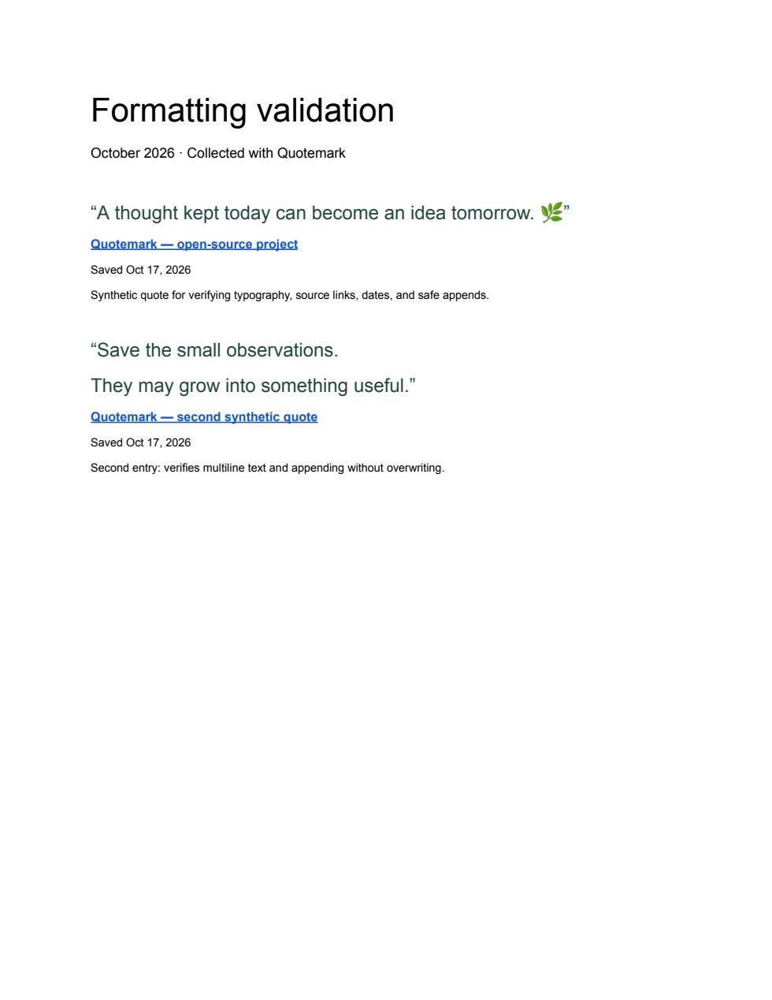

# Validation record

## Automated checks

Run `npm test` and `npm run check` from the repository root.

Covered with local fakes, without network access:

- Unicode and multiline capture, control-character removal, and source URL sanitization.
- Google Docs ranges, linked source title, capture date, optional note, and append position.
- Atomic named-range marker and revision precondition for retry deduplication.
- Concurrent local mutations, including recovery after a failed mutation.
- Offline save, explicit account connection, folder/document creation, and local status updates.
- A simulated response loss after Google committed a write, followed by retry without duplication.
- Google account changes and isolation of quotes associated with the original account.
- Rejection of website-origin messages attempting to invoke privileged extension actions.

## Browser preview

`node scripts/preview.mjs` serves the production UI with an isolated fake Chrome API at http://127.0.0.1:4173/library.html. The preview uses synthetic data and labels itself as a preview. It is excluded from all extension ZIPs.

Manually verified in Chrome on October 17, 2026: library rendering, quote creation (count increased from 3 to 4), search (one matching result), favorites (one result), collection filtering (two results), the compact popup layout, and a Markdown export downloaded through the interface and inspected on disk.

For the 0.1.1 redesign, the browser preview was checked again for search, favorites, collection filtering, saving a quote with a source link and note, settings, and the export menu. The library was visually checked at 1470px and 375px widths; the narrow view had no horizontal overflow. The compact popup, monochrome icon, and promotional artwork were also visually inspected. The original Markdown download check above predates the redesign; a repeated download observation was interrupted by browser automation timing out.

This preview verifies rendering and UI interactions; it is not an end-to-end Google authorization or Chrome extension installation test.

The release build guard was also checked: `npm run build:release` correctly refuses to package a Drive-enabled release until a real OAuth client is configured.

## Live Google Docs API validation

On October 17, 2026, the exact `buildAppend` requests from the extension source were applied to a new private Google Doc through the connected Google Drive tool. Two synthetic quotes were appended using Google revision preconditions. Readback confirmed both quotes, one collection/month heading, linked source titles, capture dates, notes, and two named-range retry markers. The real named range was also recognized by the extension’s `hasMarker` function.

The document was exported as a one-page PDF and rendered for visual inspection. Typography, spacing, Unicode, multiline text, source links, and notes were readable without clipping. This test validates Docs request compatibility and output; it does not validate Chrome Identity or the extension’s `drive.file` OAuth grant.

## Live release gate

Before claiming the extension is ready for general Drive use, complete the real Chrome/OAuth/Google Docs checks in [GOOGLE-SETUP.md](GOOGLE-SETUP.md#5-verify-live-behavior). Record the tested Chrome version, extension ID, package version, successful document link (privately if needed), and result. Do not put real access tokens or personal quotes in this repository.
